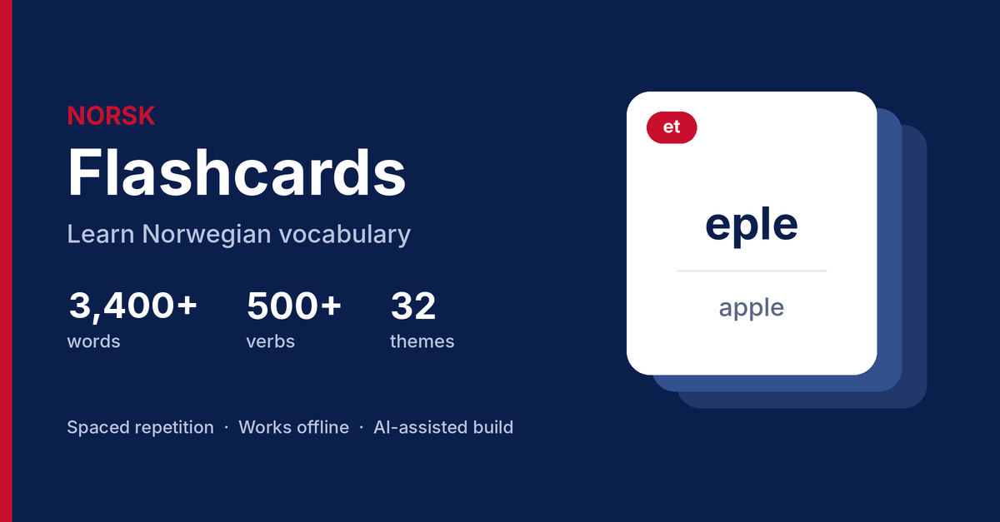

# Norsk Flashcards

[](https://mvclima.github.io/norsk-flashcards/)

A free web app for learning Norwegian (Bokmål) vocabulary, built by **Marcus Lima** ([LinkedIn](https://www.linkedin.com/in/mvcarvalholima/)) for his own study of Norwegian, working towards level A2–B1.

**Live app:** https://mvclima.github.io/norsk-flashcards/

- **3,200+ words** in **32 themes** (food, home, work, society, the body, verbs, adjectives, expressions…), each with English translation, grammatical gender and a note: plurals, verb forms, example sentences or usage tips.
- Works on phone and computer, can be installed as an app and works offline.
- No account, no tracking of personal data.

## Features

| Feature | What it does |
|---|---|
| **Flashcards** | Study one theme or one group at a time, in both directions (Norsk → English / English → Norsk). Filter by group, by kind of word or by the ones you missed. Remembers where you stopped. |
| **Practice** | All words from every theme in one shuffled deck. A word you mark *Knew it!* leaves the deck. |
| **Review** | Spaced repetition: every answer schedules the word for review after 1, 3, 7, 14, 30 or 60 days. |
| **Verbs** | Practise the present, past and perfect of 500+ verbs. Filter by strong verbs (vowel change). |
| **Gender** | Choose *en*, *ei* or *et* for 1,600+ nouns. Follows the Bokmål rule that *ei* words also accept *en*. |
| **Search** | Find any word in Norwegian or English, also by part of a word and without special letters (*vaeske* finds *væske*). |
| **Progress** | Words known, reviews due, learning vs. mastered, daily goal, streak and progress per theme. |
| **NO / EN** | A switch in the header shows the names of themes, sections and word groups in Norwegian or English. |
| **Settings** | Light, dark or automatic appearance (follows the device). |
| **Help** | How everything works, inside the app. |
| **Pronunciation** | Every card can be read aloud with the device’s Norwegian voice. |

## Technology

- **One HTML file** with plain HTML, CSS and JavaScript. No framework, no build step, no backend.
- **Vocabulary as data** inside the page: a `THEMES` object with themes → groups → cards (`[gender, Norwegian, English, note]`). The app renders everything from it.
- **Web Speech API** (`speechSynthesis`) for pronunciation, using the voices installed on the device.
- **localStorage** for all progress, positions, review schedule, daily goal and settings. Data never leaves the browser.
- **Progressive Web App**: `manifest.webmanifest`, icons and a service worker (`sw.js`) for installation and offline use. Pages and files are fetched network-first, so updates arrive straight away, with the saved copy as fallback offline.
- **Spaced repetition**: a simple Leitner-style system with six steps.
- **Hosting**: GitHub Pages.
- **Visit counter**: [GoatCounter](https://www.goatcounter.com/), which counts visits without cookies or personal data.

## How it was made: AI and my part

I built this together with **Claude** (Anthropic’s AI assistant), in two long conversations (several hundred messages), starting on 15 November 2026. I want to be clear about who did what.

**What Claude did**
- Wrote and changed all of the code (HTML, CSS, JavaScript, service worker, manifest).
- Drafted vocabulary, translations, grammar notes and example sentences, and suggested missing words and features.
- Checked its changes with automated browser tests (headless Chrome via Playwright) before publishing, and committed to this repository.

**What I did**
- **Starting point**: on 15 November 2026 I sent photos of my Norwegian textbook (chapter 6, *På kjøpesenteret*, p. 85) and asked for flashcards of the 42 clothing items in the pictures, and the app grew from there.
- **Product decisions**: what the app should do and in what order: the themes and their order, the menu sections, switching the interface from Portuguese to English, button placement (Reset next to Shuffle, a Back button next to *Knew it!*), Practice, Search, the side menu, spaced repetition, the Gender and Verbs trainers, the daily goal, the Help page, the name and the icon.
- **Vocabulary sources and curation**: the words come from my textbook, from lists I typed in (for example the colours and a long list of adjectives), from my own vocabulary spreadsheet in Google Sheets (the A2/B1 verbs were picked from its Verbs tab), and from themes I described and Claude filled in (food, the home room by room). Since then I have kept adding words one by one from what I read and hear: a recruitment email, a language-lesson post, expressions on a whiteboard, everyday situations. I decided which words to add, where each one belongs and how it should be shown (for example, removing duplicates, using the singular with its gender instead of plural-only cards, and splitting themes and groups that had grown too large).
- **Review**: I read the cards, questioned words and translations (spelling, meaning, false friends) and asked for corrections when something was wrong or unclear.
- **Testing**: I used the app daily on Android and on a Windows computer, installed it as an app and reported problems, for example: the app not resuming at the last card, *Reset stats* not resetting the score or the progress bar, the wrong first theme on first visit, and the old app name still showing in the install dialog.
- **Publishing**: set up this repository, GitHub Pages and GoatCounter.

AI wrote the code; the requirements, priorities, content choices and acceptance testing were mine.

## Run it locally

No installation needed. Download the repository and open `index.html` in a browser.
To test installation and offline mode, serve the folder over HTTP, for example:

```bash
python3 -m http.server 8000
# then open http://localhost:8000
```

## Files

| File | Purpose |
|---|---|
| `index.html` | The whole app: layout, styles, vocabulary data and logic |
| `manifest.webmanifest` | App name, colours and icons for installation |
| `sw.js` | Service worker for offline use |
| `icons/` | App icons (Norwegian flag) |

## Add or change a word

Each card is one line in the `THEMES` object in `index.html`:

```js
['en','bart','moustache','pl. barter · skjegg = beard'],
//  gender  Norwegian  English   note (optional)
```

Gender is `en`, `ei`, `et`, `pl` (plural only), `adj`, `verb` or `x` (expression or other).

## License

[MIT](LICENSE) © 2026 Marcus Lima
